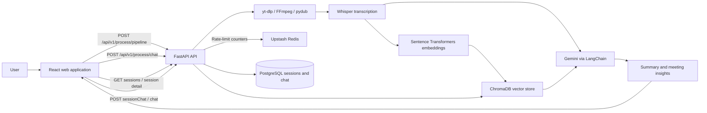

# TransVerse — AI Video Assistant

> **Project documentation**
> TransVerse turns recorded meetings and videos into searchable, actionable notes.

## 1. Introduction

TransVerse is a web application for understanding recorded meetings and other spoken-content videos. A user provides a YouTube URL or a media-file path available to the backend. The application extracts and transcribes the audio, then uses generative AI to produce a concise summary, action items, key decisions, and open questions. Users can inspect the transcript and ask follow-up questions grounded in it.

The project is intended to reduce the time spent replaying recordings, writing notes, and finding decisions or follow-ups after a meeting.

### Project objectives

- Turn meeting recordings into readable, structured notes.
- Make transcripts easier to search through natural-language questions.
- Keep analysis results accessible in the signed-in user's history.
- Provide a clear web interface for submitting media and reviewing results.

## 2. Scope and capabilities

| Capability | Current behavior |
|---|---|
| Media input | Accepts a YouTube URL or a file path accessible to the backend machine. The UI accepts a path; it does not upload a file. The source form offers English and Hinglish language choices, but the current pipeline does not yet apply the selection. |
| Audio preparation | Downloads YouTube audio or converts local media to mono, 16 kHz WAV, then splits it into chunks. |
| Transcription | Uses OpenAI Whisper locally to generate a transcript. |
| Meeting insights | Generates a title and summary and extracts action items, key decisions, and open questions with a Google Gemini model. |
| Transcript Q&A | Retrieves relevant transcript chunks from Chroma and asks a Gemini model to answer using that context. |
| Results history | Saves analysis sessions and chat messages in PostgreSQL for the signed-in user; users can reopen analyses from History. |
| Accounts | Registration and login are available. Analysis, history, and chat API endpoints use the authenticated user's cookie. |

## 3. Use cases

1. **Meeting recap** — A meeting organizer analyzes a recording and shares the summary and decisions with attendees.
2. **Action tracking** — A team member reviews extracted tasks, owners, and deadlines to identify follow-ups. The model can only report owners or deadlines that are present in the transcript.
3. **Decision discovery** — A participant checks the key decisions without replaying the full recording.
4. **Transcript question answering** — A user asks a question about the recording and receives an answer based on retrieved transcript passages.
5. **Interview or research review** — A researcher or analyst transcribes spoken material, scans the summary and open questions, and asks focused follow-up questions.
6. **Personal analysis history** — A signed-in user reopens analyses saved to their account.

Use the application only with media you are authorized to process. Confirm important decisions and tasks against the original recording; generated output may be incomplete or incorrect.

## 4. User roles and responsibilities

The roles below describe intended user personas, not enforced application permissions.

| Role / persona | Typical responsibilities |
|---|---|
| Meeting organizer | Submits a recording, reviews the generated recap, and shares confirmed follow-ups with the team. |
| Meeting participant | Checks the transcript, decisions, and action items, and asks questions about the meeting. |
| Researcher / analyst | Reviews interviews or other recorded material and uses the transcript to locate relevant information. |
| Platform operator / developer | Configures the backend, database, model-provider credentials, and runtime dependencies; monitors and maintains the service. |

**Authorization status:** Session and chat API routes scope database records to the signed-in user. The application does not provide role-based access control (RBAC), team workspaces, or shared-history permissions. The home and history pages are not wrapped in a client-side route guard; protected API requests still require authentication.

## 5. Technology stack

| Layer | Technologies | Purpose |
|---|---|---|
| Web client | React 19, JavaScript, Vite 8 | Single-page application, development server, and production build. |
| UI and navigation | Tailwind CSS 4, Lucide React, React Router 7 | Responsive styling, icons, and client-side routes. |
| Result rendering | React Markdown, remark-gfm | Renders generated summaries and chat responses as Markdown. |
| Relational persistence | PostgreSQL, SQLAlchemy, psycopg | Stores accounts, analysis sessions, and chat messages. |
| API | Python, FastAPI, Uvicorn, Pydantic | REST endpoints, request validation, and local API serving. |
| Database migrations | Alembic | Migration tooling is installed; apply appropriate migrations to create/update the database schema. |
| Rate limiting | Upstash Redis (`upstash-redis`) | Stores shared per-IP token-bucket and sliding-window counters for API rate limits. |
| Audio extraction and preparation | yt-dlp, FFmpeg, pydub | Gets YouTube audio and converts/chunks media for transcription. |
| Speech recognition | OpenAI Whisper, `openai-whisper` | Runs speech-to-text transcription locally. |
| AI orchestration | LangChain and LangChain integrations | Composes prompts, language-model calls, text splitting, embeddings, and retrieval. |
| Generative AI | Google Gemini through `langchain-google-genai` | Produces the title, summary, extracted meeting insights, and transcript-grounded answers. |
| Embeddings and vector retrieval | `sentence-transformers`, `all-MiniLM-L6-v2`, ChromaDB | Embeds transcript chunks and retrieves passages relevant to a question. |
| Authentication primitives | PyJWT, pwdlib with Argon2 | Supports password hashing and JWT-based account authentication in backend endpoints. |

## 6. How the technologies work together

1. **React and Vite** render the dashboard and send requests to the FastAPI service.
2. **FastAPI** validates the processing request and coordinates the backend pipeline.
3. **yt-dlp** downloads audio when the source is a supported video URL. For a local path, **pydub** uses **FFmpeg** to convert the media to a transcription-friendly WAV format.
4. **Whisper** transcribes the audio in chunks. The resulting transcript is the source material for subsequent analysis.
5. **LangChain** sends transcript text to **Google Gemini** to generate a title, summary, action items, decisions, and open questions.
6. For Q&A, the transcript is split into smaller passages, embedded with **Sentence Transformers**, and stored in **ChromaDB**. Relevant passages are retrieved and supplied as context to Gemini.
7. **Upstash Redis** applies per-IP rate limits to selected API routes using token-bucket and sliding-window algorithms.
8. The backend stores the analysis session and chat messages in **PostgreSQL**. The frontend retrieves saved sessions and messages through authenticated API routes. For each question, the backend reconstructs a RAG chain using the configured Chroma store.

## 7. High-level architecture



## 8. Main application workflow

1. Enter a YouTube URL or a backend-accessible media-file path in the input panel.
2. Start the analysis. The backend downloads or converts the audio and creates audio chunks.
3. Whisper transcribes the audio. The service generates the title, summary, action items, key decisions, and open questions.
4. The transcript is indexed for retrieval and a session identifier is returned to the frontend.
5. Review the results and transcript, then ask questions in the meeting chat.
6. Reopen an analysis from History. The frontend loads its saved analysis and previous chat messages from authenticated API endpoints.

## 9. API overview

The development API is served at `http://localhost:8000`; interactive API documentation is available at `/docs`.

| Method | Endpoint | Purpose |
|---|---|---|
| `GET` | `/health` | Basic service health check. |
| `POST` | `/api/v1/process/pipeline` | Process a source. Request body: `{"source":"...", "language":"english"}`. Returns a session ID, status, title, summary, action items, decisions, open questions, and transcript. Requires the authentication cookie. |
| `GET` | `/api/v1/process/sessions` | List the signed-in user's saved analysis sessions. Requires the authentication cookie. |
| `GET` | `/api/v1/process/sessions/{session_id}` | Load one saved analysis. Requires the authentication cookie and ownership of the session. |
| `POST` | `/api/v1/process/chat` | Ask about a completed session. Request body: `{"session_id":"<uuid>", "question":"..."}`. Requires the authentication cookie. |
| `POST` | `/api/v1/process/sessionChat` | Load saved messages for a session in chronological order. Request body: `{"session_id":"<uuid>"}`. This is a POST endpoint, not GET. Requires the authentication cookie. |
| `POST` | `/api/v1/auth/register` | Register an account. |
| `POST` | `/api/v1/auth/login` | Authenticate an account and return a token. |
| `POST` | `/api/v1/auth/logout` | Clear the authentication cookie. This does not revoke already-issued tokens. |
| `GET` | `/api/v1/users/getUser` | Return the authenticated user's profile; requires the backend's authentication cookie. |
| `DELETE` | `/api/v1/users/account` | Authenticated placeholder route; currently returns the account ID and does not delete the account. |

Registration and login are public. Login sets an HttpOnly `access_token` cookie; send it with credentials on protected API requests. Analysis sessions and chat messages are stored in PostgreSQL. Logout clears the cookie; it does not revoke already-issued tokens.

Selected routes are rate-limited per client IP using Upstash Redis. Registration and login each allow up to 5 requests per 5 minutes (sliding window); logout allows 10 per 5 minutes. Processing allows a burst of 1 request and refills at 1 request per hour; chat and session-history routes have configured per-IP limits. The profile endpoint allows a burst of 30 and refills at 20 requests per minute. Rejected requests return HTTP `429` with a `Retry-After` header.

## 10. Run locally

### Prerequisites

- Python 3 and Node.js/npm.
- PostgreSQL, with a database available for the configured connection string.
- An Upstash Redis database with REST credentials for shared API rate limiting.
- FFmpeg installed and available on `PATH`.
- A Google AI API key for Gemini-powered generation.
- Access to the media source. Local media paths must be readable by the backend process.

### Configure the backend

In PowerShell:

```powershell
cd backend
py -m venv .venv
.\.venv\Scripts\Activate.ps1
python -m pip install --upgrade pip
python -m pip install -r requirements.txt
```

Create `backend/.env` and set values for the settings consumed by the application:

```dotenv
DATABASE_URL=postgresql+psycopg://<user>:<password>@localhost:5432/<database>
JWT_SECRET_KEY=<generate-a-long-random-secret>
GOOGLE_API_KEY=<your-google-ai-api-key>
UPSTASH_REDIS_REST_URL=<your-upstash-redis-rest-url>
UPSTASH_REDIS_REST_TOKEN=<your-upstash-redis-rest-token>
```

The backend connects to Upstash Redis during application startup. Keep real secrets out of source control. Install FFmpeg separately and confirm that `ffmpeg` is available on `PATH`.

Start the API from the `backend` directory:

```powershell
python -m uvicorn server:app --reload
```

### Configure the frontend

In a second terminal:

```powershell
cd frontend
npm install
npm run dev
```

Open the Vite URL printed in the terminal (the current development CORS configuration expects `http://localhost:5173`). The frontend currently targets the backend at `http://localhost:8000`.

### Useful frontend commands

```powershell
npm run lint
npm run build
```

## 11. Configuration and data handling

| Setting / data | Description |
|---|---|
| `DATABASE_URL` | SQLAlchemy PostgreSQL connection string. |
| `JWT_SECRET_KEY` | Secret used by the backend to sign authentication tokens. Use a strong, private value. |
| `GOOGLE_API_KEY` | Credential used by the LangChain Gemini integration. |
| `UPSTASH_REDIS_REST_URL` | Upstash Redis REST endpoint used by the backend rate limiter. |
| `UPSTASH_REDIS_REST_TOKEN` | Secret token used to authenticate rate-limiter requests to Upstash Redis. |
| `WHISPER_MODEL` | Optional Whisper model name; defaults to `small` in the transcription module. |
| Analysis history and chat | Stored in PostgreSQL and scoped to the signed-in user by the session API routes. |
| Chat RAG chain | Reconstructed by the backend for each question from the configured Chroma vector store. |
| Vector index | ChromaDB uses a local persistence directory configured in the backend code. The current session-vector loader does not filter retrieved documents by session or user; session-specific retrieval isolation is not yet implemented. |
| Media files | Downloaded and converted media are written to backend-local working directories. Plan and perform appropriate cleanup for your deployment. |

## 12. Screenshots

Add your screenshots in the placeholders below.

### Dashboard and source input

<!-- Add dashboard screenshot here -->

### Analysis results and transcript

<!-- Add analysis results screenshot here -->

### Meeting chat

<!-- Add chat screenshot here -->

### Analysis history

<!-- Add history screenshot here -->

## 13. Current limitations and production considerations

- The language selector is sent with the processing request, but the current pipeline does not yet use it to configure transcription or generation.
- The source input accepts a URL or backend-local path; the interface does not upload local files from the user's device.
- Rate limiting depends on a reachable Upstash Redis instance and the two Upstash REST environment variables. A Redis connection failure during startup prevents the application lifespan from completing.
- Session and chat records are stored in PostgreSQL and linked to accounts, but the current Chroma loader does not isolate retrieval by session/user. Add and verify vector metadata filtering before using this for multiple users or sensitive recordings.
- The client-side home and history routes do not have a route guard; authentication is enforced by protected API endpoints.
- There are no implemented user roles, team workspaces, or shared-history permissions.
- The current CORS origin and frontend API URL are development settings; production deployment should externalize and restrict them.
- Configure HTTPS, secure cookie settings, secret management, input and resource limits, error handling, retention/cleanup, observability, and database migrations before production use.
- Generated summaries and extracted tasks can be inaccurate. Review output against the source before acting on it.

## 14. Repository layout

```text
backend/
  app/
    api/v1/          Versioned API routes
    config/          Backend settings
    core/            Rate limiting and security primitives
    db/              PostgreSQL and Redis clients
    dependencies/    Processing, user, and retrieval dependencies
    models/          SQLAlchemy user, analysis-session, and chat-message models
    schema/          Request and response models
    utils/            Audio, transcription, summarization, and vector-store utilities
  requirements.txt
  server.py          FastAPI application entry point
frontend/
  src/
    Components/      Shared interface components
    context/         Client application state and history
    pages/           Home and History screens
  package.json
```